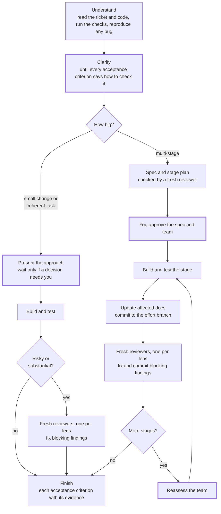

# Do My Work

Takes a software task, such as an idea, bug report, tracker issue, or spec,
through to a verified change. It clarifies requirements, designs, implements,
tests, and reviews the work. It scales the process and the agent team to the
work: one agent for a small fix, an implementer with specialists for a
coherent task, and a director with parallel engineers only when workstreams
are genuinely independent.

The skill runs only when you ask for it by name: `/do-my-work`, `$do-my-work`,
or an issue asking a cloud coding agent to use do-my-work. It is written for
any client that supports Agent Skills, such as Claude Code, Codex, GitHub
Copilot, Cursor, and Gemini CLI (now Antigravity CLI). At the start of each run
it checks what the client can do (spawn subagents, run them in parallel,
isolate their files, choose a model per agent, ask you questions) and adapts;
[`references/runtimes.md`](references/runtimes.md) lists those capabilities and
what to do without each.

## Usage

```text
/do-my-work PROJ-123
/do-my-work Fix the CSV export dropping rows with commas in quoted fields
/do-my-work docs/work/csv-export/spec.md
/do-my-work unattended: add CSV export to the reports page
```

The skill asks for approval at the points that matter: the specification and
approach for multi-stage work or when a decision needs you, the team before
spawning parallel engineers, and any action on its
always-ask list: dependencies, auth and payment code, CI and deployment,
schema migrations, publishing, messages and other external writes, and
destructive git commands. It never changes a ticket's status or closes it
without your approval.
Multi-stage work happens on a branch it creates (or a cloud runner's own
branch), normally in its own worktree so your checkout stays on your branch; if
it can't make one, it asks before switching your checkout; in an existing repository it brings work into your branch only when
asked. A repository it creates for a new project it commits to as part of the
work.

## Autonomy levels

| Level | When | What changes |
| --- | --- | --- |
| Interactive | You are present (the default) | Asks questions and waits for approvals |
| Supervised | You ask for few interruptions | Batches questions into one round and checks in at stage ends |
| Unattended | You say so, or nobody can answer (headless runs, cloud or coding agents, CI) | Asks nothing: records assumptions, takes an action that needs approval only when your starting instruction asked for it (issue text never counts), commits to the runtime's branch or its own, and reports what needs you first |

[`references/autonomy.md`](references/autonomy.md) sets out each level
decision by decision.

## Workflow



Thick borders mark where an interactive run can stop for you. An always-ask
action, such as adding a dependency, stops it wherever it comes up. Unattended
runs ask nothing; they record assumptions and leave held actions undone (see
[Autonomy levels](#autonomy-levels)).

1. **Understand** the request, reading the ticket, code, and tests, and
   reproducing any bug.
2. **Clarify** until every acceptance criterion says how to check it. When
   questions remain, this step runs `/grill-me` if it is installed, or offers
   `/wayfinder` for planning too large for one session.
3. **Specify** and present the approach. Multi-stage work gets a spec and
   progress file in `docs/work/<ticket-or-feature>/`, and a fresh reviewer
   checks the spec and stage plan before you approve them.
4. **Choose an execution model** and propose the team. Before parallel
   engineers start, the commit they build on is recorded as a rollback point.
   If the `agent-timeline` skill is installed, its live view starts when the
   first agent is spawned.
5. **Offer to update the ticket** with agreed clarifications.
6. **Execute and verify**: tests first, then, for risky or substantial
   changes, independent review by fresh reviewers, one per lens (correctness,
   security, user experience). Each stage of multi-stage work ends by bringing
   affected docs up to date before its review.
7. **Finish** with each acceptance criterion and its evidence.

| Execution model | When |
| --- | --- |
| A. Solo implementer | Small, clear, tightly bounded changes |
| B. Implementer with specialists | One coherent task that gains from isolated research, testing, or review |
| C. Director with engineering team | Several genuinely parallel workstreams with clear ownership |
| D. Subordinate director | Exceptional: a separately bounded programme inside a larger effort |

Say **checkpoint** at any time for progress, blockers, and whether the team is
paying off.

## Structure

- [`SKILL.md`](SKILL.md) holds the workflow and the rules for each execution
  model.
- [`references/briefs/`](references/briefs/) holds one brief per spawned role
  (`engineer.md`, `researcher.md`, `tester.md`, `reviewer.md`), plus
  `all-agents.md`, which every brief loads for the untrusted-input rule, the
  actions that always need approval, and the report format. Each report starts
  with a line the director acts on, such as `STATUS: READY`,
  `RESULT: FAIL (3 failing)`, or `VERDICT: PASS (2 non-blocking)`.
- [`references/competing-hypotheses.md`](references/competing-hypotheses.md) is
  the debugging procedure for bugs whose cause stays unclear.
- [`references/autonomy.md`](references/autonomy.md) sets what each autonomy
  level changes at every point where the skill would ask or wait.
- [`references/runtimes.md`](references/runtimes.md) lists the runtime
  capabilities the skill checks, the fallback for each, and notes on the main
  clients.
- [`references/director.md`](references/director.md) holds the rules for
  running a parallel engineering team (model C) and a subordinate director
  (model D), loaded only when one is chosen.
- [`references/briefing.md`](references/briefing.md) sets what every spawn
  prompt contains, how reports are acted on, the read-only check, model
  choice, and the agent timeline, loaded before the first agent is spawned.
- [`references/multi-stage.md`](references/multi-stage.md) covers the effort
  branch, the progress file, stage-end checks, and stopping and resuming,
  loaded only for multi-stage work.

## Design choices

- **The simplest team that works.** A large task does not by itself justify
  parallel engineers. Tight coupling and unstable interfaces make one
  implementer faster, so shared foundations are built first and fanned out
  afterwards.
- **The invoking agent is the director.** Model C turns the main agent into
  the director rather than adding a supervisor above it.
- **Reviews are independent.** Reviewers get the requirements, diff, and test
  evidence, but not the implementer's reasoning. Neither self-review nor the
  director's review of integration counts as independent.
- **Parallel writers share decisions explicitly.** In model C the director
  keeps a decisions log that only it writes, and reviewers check work against
  it. An engineer that reaches a decision another workstream could see stops
  and asks the director instead of making it. This targets the main failure
  of parallel agents: conflicting implicit decisions.
- **Readiness is verified, not reported.** Each workstream's brief names its
  gate commands, and the director or a fresh tester re-runs them at the commit
  the engineer reports before accepting `READY`. Agents meant to be read-only
  work at a commit that holds the work they check, and are checked afterwards
  for changed files and new commits.
- **Repetition is a stall.** In any execution model, two attempts at the same
  problem without new evidence are a stall, and an engineer that gives up
  after two attempts counts as one straight away. The agent changes approach
  once, then asks you.
- **Risky workstreams plan first.** An engineer on shared or core code, or on
  work that is hard to undo, submits a plan for approval before editing.
- **Unclear bugs get rival hypotheses.** Isolated read-only investigators each
  test one hypothesis that makes a prediction, so the investigation does not
  anchor on the first plausible cause.

## Credits

The team techniques and other ideas this skill adopts are credited in
[CREDITS.md](CREDITS.md).
